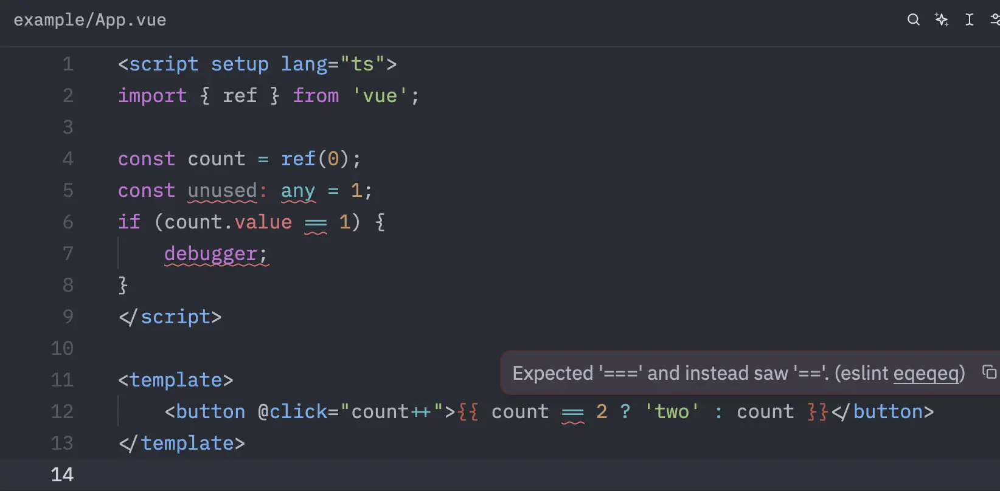

# eslint-plugin-vue-contentmapper

PoC: lint `.vue` files through the TypeScript that `@vue/content-mapper` ([vuejs/language-tools#6170](https://github.com/vuejs/language-tools/pull/6170)) generates for them.

Each `.vue` file is transformed into virtual TypeScript and linted as is. Reports are mapped back to the original file through the content mapper's span mappings; reports that cannot be mapped back, i.e. those on generated code, are dropped.



```js
// eslint.config.js
import vueContentMapper from 'eslint-plugin-vue-contentmapper';

export default [
  ...vueContentMapper.configs.base,
  {
    files: ['**/*.vue/*.{js,jsx,ts,tsx}'],
    rules: { eqeqeq: 'error' },
  },
];
```

Content mappers are a built-in mechanism of tsgo (TypeScript 7), so tsgo-based linters such as [Rslint](https://rslint.rs) could build on them to lint DSLs with strongly consistent semantics: the code they lint would be exactly what the type checker sees.
